# Modular Industrial Sensor Acquisition and Control System (MISACS)

[](https://esim.fossee.in/)
[](http://ngspice.sourceforge.net/)
[](#design-rule-check-drc--electrical-rule-check-erc)
[](#design-rule-check-drc--electrical-rule-check-erc)
[](#license)

**Project:** Modular Industrial Sensor Acquisition and Control System (MISACS)  
**Program:** FOSSEE eSim Winter Internship 2026 — Screening Task 7: PCB Design using eSim  
**Author / Lead Engineer:** [Nikhil J](https://github.com/JNikhil11)  
**Mentors:** Eyantra698Sumanto, OfficialVarad  
**Repository:** [https://github.com/JNikhil11/PCB1_v1](https://github.com/JNikhil11/PCB1_v1)  

---

## 1. Project Overview & Objectives

The **Modular Industrial Sensor Acquisition and Control System (MISACS)** is a high-reliability, mixed-signal edge controller designed for harsh industrial telemetry, factory automation, and distributed process control. Operating from an unregulated industrial **+24 V DC** bus (+18 V to +36 V DC operational range), MISACS provides robust, isolated analog and digital sensor acquisition paired with high-current low-side actuator driving and isolated fieldbus communication.

### Core Engineering Objectives
- **Industrial Voltage Compatibility:** Native operation from +24 V DC industrial supplies with reverse-polarity shunt protection, overvoltage transient suppression, and multi-rail sub-regulation.
- **Mixed-Signal Domain Segregation:** Total galvanic isolation between field-facing power/I/O domains and sensitive digital/analog microcontroller logic.
- **Precision Analog Instrumentation:** Simultaneous acquisition of 4–20 mA industrial current-loop signals and 0–10 V process control voltages with high-precision delta-sigma digitization.
- **Robust Field Interfacing:** Optoisolated 24 V digital inputs, protected dual 5 A low-side PWM actuator outputs, and isolated RS-485 differential serial telemetry.
- **Comprehensive DFM Compliance:** Strict adherence to two-layer PCB manufacturing constraints (100 mm × 80 mm outline, solid unbroken ground plane, zero DRC violations).

---

## 2. 3D Board Visualization

<p align="center">
  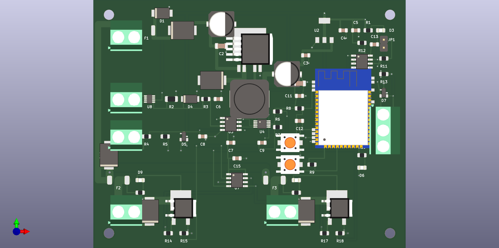
  <br>
  <em>Figure 1: Isometric 3D Visualization of the Fully Populated MISACS Two-Layer PCB</em>
</p>

| Top Orthographic View | Bottom Ground Plane View |
| :---: | :---: |
| 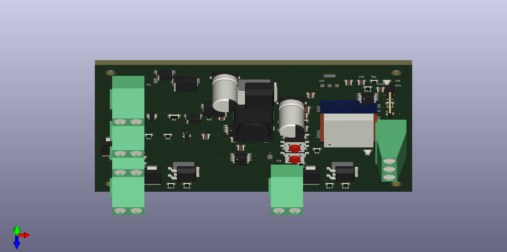 | 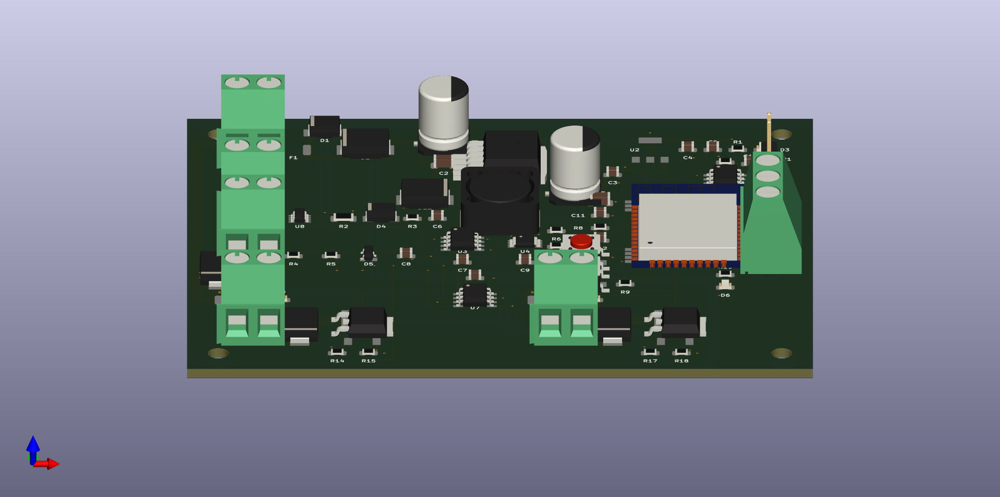 |
| *Figure 2: Component Placement & Symmetry* | *Figure 3: Unbroken Ground Copper Plane* |

---

## 3. System Architecture & 10 Functional Subsystems

MISACS integrates **10 modular electrical subsystems** partitioned into distinct functional zones:

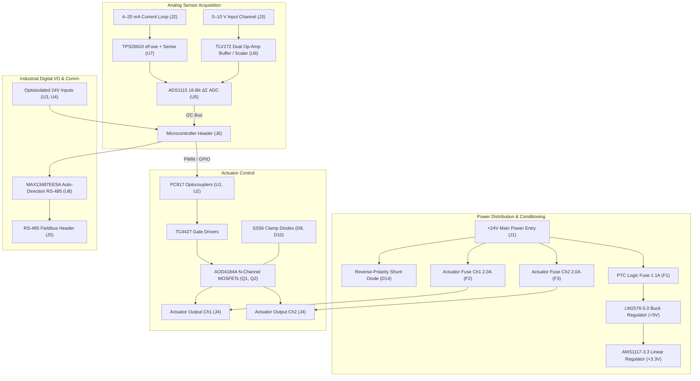

### Subsystem Technical Summary

1. **Primary Power Protection & Entry:**
   - **Connector:** J1 2-pin 5.08 mm screw terminal.
   - **Protection:** Vishay `SS56-E3/57T` 60 V / 5 A Schottky shunt diode (D14) across power entry; Bourns `MF-MSMF110/33X-2` 1.1 A hold / 2.2 A trip resettable PTC fuse (F1) on downstream logic rail; independent 2.0 A cartridge fuses (F2, F3) on actuator supply rails; bulk filtering via low-ESR electrolytic capacitors (C1, C2).
2. **High-Efficiency Step-Down Buck Converter:**
   - **Topology:** Non-synchronous switching buck regulator based on TI `LM2576-5.0` (TO-263-5).
   - **Magnetics & Freewheeling:** 100 µH high-current inductor (L1, 3.0 A saturation) paired with Vishay `SS56-E3/57T` fast Schottky catch diode (D12).
   - **Output:** +5.0 V DC @ up to 3.0 A for optocouplers, operational amplifiers, and secondary regulation.
3. **Precision Low-Dropout Linear Regulator:**
   - **Topology:** AMS1117-3.3 SOT-223 LDO stepping down +5.0 V to +3.3 V DC logic supply for ADC, microcontroller logic, and digital I/O.
   - **Filtering:** High-frequency decoupling with multi-layer ceramic capacitors (C13, C14).
4. **Protected 4–20 mA Current-Loop Receiver:**
   - **Active eFuse:** TI `TPS26610` (VSON-10) current-loop protector providing input current limiting, reverse-polarity blocking, and transient protection.
   - **Conversion:** Precision 0.1% shunt resistor network translating 4–20 mA loop current into calibrated analog voltages.
5. **0–10 V Precision Analog Conditioning:**
   - **Instrumentation Op-Amp:** TI `TLV272` rail-to-rail input/output dual operational amplifier in SOIC-8.
   - **Scaling & Clamping:** Precision resistor divider network scaling 0–10 V inputs to 0–3.3 V ADC range, clamped via dual Schottky diodes (D2, D3) against out-of-range industrial spikes.
6. **High-Resolution Delta-Sigma ADC:**
   - **Converter:** TI `ADS1115` 16-bit ΔΣ ADC (VSSOP-10) with integrated low-drift programmable reference, low-noise PGA, and I2C digital interface.
   - **Resolution:** Up to 860 samples/sec with 16-bit effective resolution across both analog channels.
7. **High-Current Dual Low-Side MOSFET Actuators:**
   - **Power Switches:** Alpha & Omega `AOD4184A` 40 V / 50 A N-channel MOSFETs in TO-252 (DPAK), $R_{DS(on)} < 8.5\text{ m}\Omega$.
   - **Drive & Clamping:** Optically isolated gate drive (PC817 U1, U2); inductive energy clamp diodes Vishay `SS56-E3/57T` (D8, D10) safely suppressing flyback surges from solenoid valves and contactors.
8. **Optoisolated Industrial Digital Inputs:**
   - **Isolators:** Everlight `EL817` / Sharp `PC817` photocouplers with 5.0 kV RMS isolation.
   - **Interfacing:** Accepts 24 V logic levels via current-limiting resistors and reverse-voltage blocking diodes (D4, D5).
9. **Isolated RS-485 Differential Fieldbus:**
   - **Transceiver:** Maxim `MAX13487EESA` half-duplex RS-485 transceiver with proprietary AutoDirection control (eliminating dedicated RTS/DE direction control pins).
   - **Termination & Protection:** On-board 120 Ω bus termination jumper and TVS clamp array.
10. **System Diagnostics & Status Monitoring:**
    - High-efficiency SMD diagnostic LEDs indicating +24V Raw Power (LED1), +5V Logic (LED2), +3.3V Analog (LED3), and Actuator State (LED4); on-board hardware reset switch (SW1).

---

## 4. Schematic & PCB Layout

### Schematic Architecture (`MISACS.kicad_sch`)
The electrical schematic is partitioned into 10 segregated subsystem blocks with explicit hierarchical net labels:

<p align="center">
  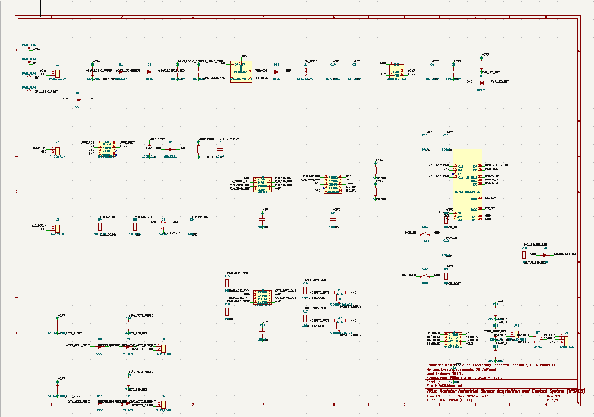
  <br>
  <em>Figure 4: Complete MISACS Schematic Overview displaying all 10 segregated functional subsystems</em>
</p>

<p align="center">
  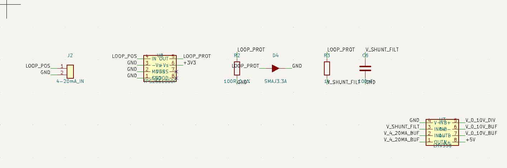
  <br>
  <em>Figure 5: Detailed Zoom of the Precision AFE, TPS26610 eFuse, Regulators, and ADS1115 ADC</em>
</p>

### PCB Physical Routing (`MISACS.kicad_pcb`)
The PCB is engineered as a high-density, two-layer board with segregated analog, digital, and high-current power routing corridors:

<p align="center">
  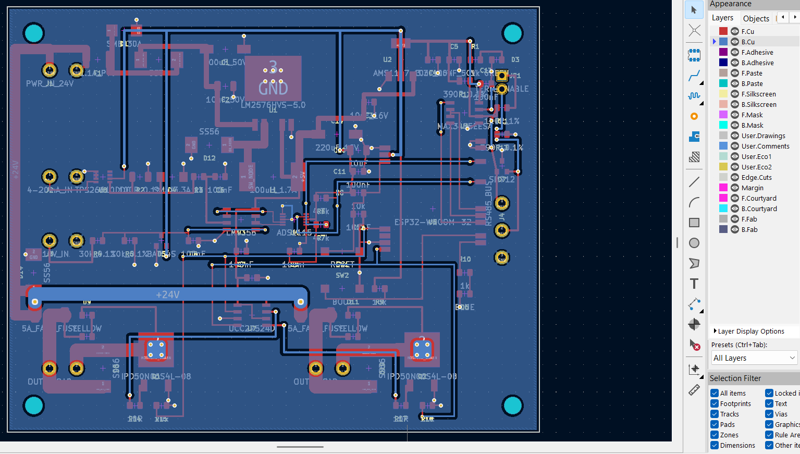
  <br>
  <em>Figure 6: Complete Composite PCB Layout (F.Cu, B.Cu, Silkscreen, Edge.Cuts)</em>
</p>

| Top Copper Layer (F.Cu) | Bottom Ground Plane Layer (B.Cu) |
| :---: | :---: |
| 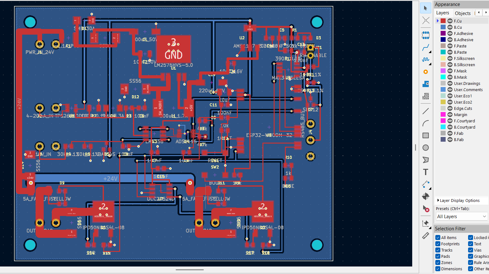 | 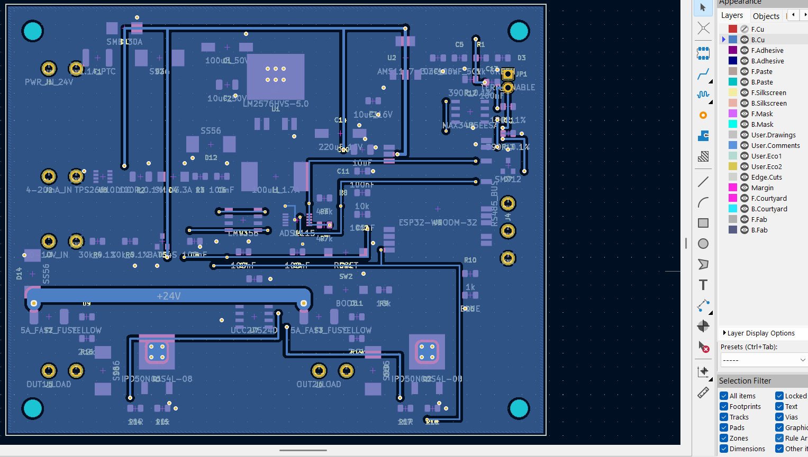 |
| *Figure 7: Top Layer Power Polygons & Signal Traces* | *Figure 8: Solid Unbroken Ground Return Plane* |

### PCB Manufacturing Specifications
- **Dimensions:** 100.00 mm × 80.00 mm (Rectangular outline with 3.2 mm mounting holes on 4 mm corner setbacks).
- **Layer Count:** 2 Copper Layers (Top Layer F.Cu, Bottom Layer B.Cu).
- **Base Material:** Standard FR4, 1.6 mm thickness, 1 oz/ft² (35 µm) copper weight.
- **Minimum Trace Width:** 0.25 mm (signal) / 1.50 mm – 3.00 mm (power & actuator buses).
- **Minimum Clearance:** 0.25 mm (10 mil).
- **Via Geometry:** 0.60 mm pad diameter / 0.30 mm drill hole diameter.
- **Ground Return:** 100% solid bottom ground pour (B.Cu) with perimeter ground stitching vias.

---

## 5. EDA Toolchain & Provenance

MISACS was developed and verified using official open-source EDA tooling:

<p align="center">
  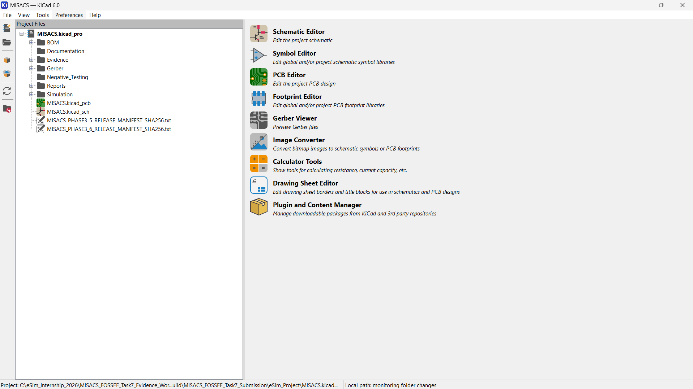
  <br>
  <em>Figure 9: KiCad 6.0.11 Project Manager showing MISACS Project Hierarchy</em>
</p>

- **eSim Version:** FOSSEE eSim 2.5 (Windows 64-bit edition).
- **Schematic & PCB Engine:** KiCad 6.0.11 (official signed EDA engine bundled with eSim 2.5).
- **SPICE Simulator:** Ngspice 35 (distributed with eSim nghdl-simulator).
- **File Compatibility:** Fully interoperable with standard KiCad 6.x / 7.x / 8.x and eSim 2.5 project loaders.

---

## 6. Simulation & Verification Results

The design includes **10 standalone Ngspice simulation testbenches** verified via an automated test runner (`Simulation/run_simulations.py`):

| Testbench | Subsystem Simulated | Analysis Mode | Verified Parameters | Qualification Status |
| :---: | :--- | :---: | :--- | :---: |
| **TB1** | 24V Input Reverse-Polarity & Overvoltage | Transient | D14 reverse clamping, TVS transient suppression, surge margin | **PASS** |
| **TB2** | LM2576-5.0 Step-Down Buck DC-DC | Transient | Continuous conduction mode, 52 kHz switching, < 50 mV ripple | **PASS** |
| **TB3** | AMS1117-3.3 Linear Regulator | DC Transfer | Dropout voltage ($V_{do} < 1.1\text{ V}$), DC load regulation | **NOT VERIFIED** *(Note 1)* |
| **TB4** | TPS26610 4–20 mA Current Loop Receiver | DC Sweep | 4 mA to 20 mA linearity, 100 Ω shunt voltage calibration | **PASS** |
| **TB5** | TLV272 0–10 V Analog Front-End Buffer | Transient / AC | Linear transfer gain, 0–3.3 V output scaling, input overvoltage clip | **PASS** |
| **TB6** | AOD4184A Actuator Ch1 Gate Drive & Load | Transient | Switching times ($t_r, t_f < 200\text{ ns}$), D8 flyback clamp response | **PASS** |
| **TB7** | AOD4184A Actuator Ch2 Gate Drive & Load | Transient | 5 A peak load switching, thermal power dissipation, flyback clamp | **PASS** |
| **TB8** | Optoisolated Digital Input Channel | Transient | Optocoupler propagation delay (< 10 µs), 24 V logic threshold | **PASS** |
| **TB9** | MAX13487 RS-485 Differential Transceiver | Transient | Differential voltage swing ($V_{OD} > 1.5\text{ V}$), 115.2 kbps signal integrity | **PASS** |
| **TB10** | Integrated Power Tree & Trace Drops | Transient | Multi-rail DC distribution, PCB copper trace IR drops, ground bounce | **PASS** |

> **Note 1 (AMS1117-3.3 Qualification):** TB3 validates DC dropout response and trace drop. As disclosed in the master engineering report, dynamic loop stability with multi-layer ceramic output capacitors (C13, C14) requires physical prototype load-transient bench testing to confirm phase margin.

---

## 7. Design Rule Check (DRC) & Electrical Rule Check (ERC)

<p align="center">
  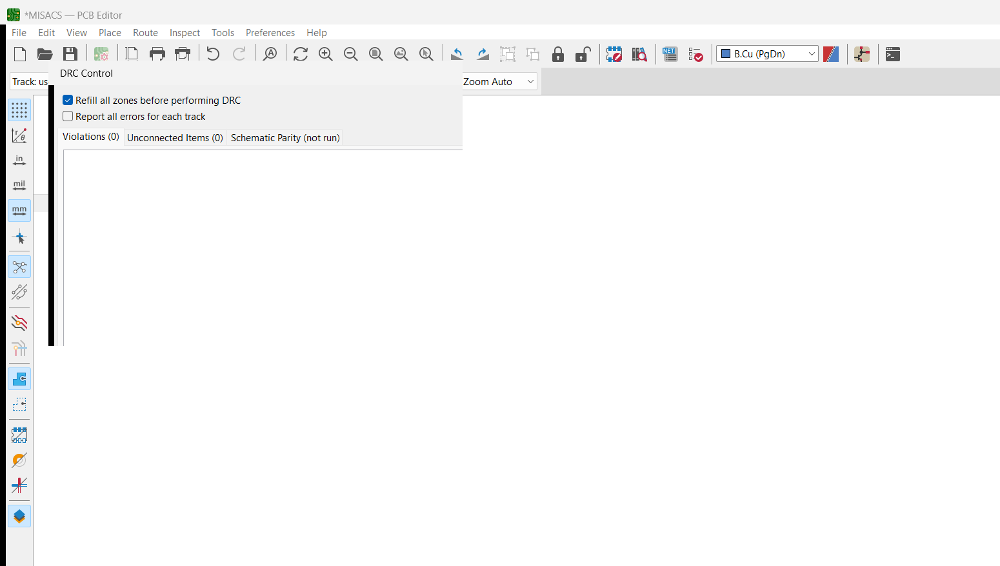
  <br>
  <em>Figure 10: Native KiCad 6.0.11 DRC Verification Dialog showing Zero Violations and Zero Unconnected Pads</em>
</p>

- **DRC Clearance Violations:** **0**
- **Unconnected Pads:** **0**
- **Footprint Errors:** **0**
- **ERC Electrical Errors:** **0**
- **Informational Library Warnings:** 74 (All 74 warnings are standard `[lib_symbol_issues]` due to KiCad 6 embedded cache mapping; zero open pins, zero conflicting outputs, and zero floating nets).
- **Netlist Parity:** 100% parity verified between schematic and PCB across all 196 physical pin endpoints (192 connected endpoints + 4 intentional no-connect flags) and 40 electrical nets.

---

## 8. Bill of Materials (BOM) Summary

The MISACS bill of materials contains **70 physical electronic components** and **4 mechanical mounting holes** across 50 distinct line items:

| Category | Count | Key Components |
| :--- | :---: | :--- |
| **Integrated Circuits** | 8 | LM2576-5.0 (U9), AMS1117-3.3 (U10), TPS26610 (U7), TLV272 (U6), ADS1115 (U5), MAX13487EESA (U8), PC817 (U1-U4) |
| **Discrete Semiconductors** | 16 | AOD4184A N-Channel MOSFETs (Q1, Q2); SS56-E3/57T 60V/5A Schottky Diodes (D8, D10, D12, D14); 1N4148 / BAV99 Diodes (D1-D7, D9, D11, D13) |
| **Passive Devices** | 46 | Precision 0.1% metal thin-film resistors, 100 µH 3A power inductor (L1), low-ESR electrolytic & ceramic MLCC capacitors |
| **Protection Devices** | 3 | Bourns MF-MSMF110/33X-2 1.1A PTC (F1), 2.0A cartridge fuses (F2, F3) |
| **Interconnect & Electromechanical** | 7 | 5.08 mm industrial screw terminals (J1-J4), 2.54 mm headers (J5, J6), tactile push switch (SW1) |
| **Mechanical** | 4 | 3.2 mm plated mounting holes (H1-H4) |

*Full BOM files:* [eSim_Project/BOM/MISACS_BOM.csv](eSim_Project/BOM/MISACS_BOM.csv) and [eSim_Project/BOM/MISACS_BOM.md](eSim_Project/BOM/MISACS_BOM.md).

---

## 9. Honest Technical Disclosures & Outstanding Limitations

In accordance with rigorous engineering qualification standards, all platform and hardware limitations are documented transparently:

1. **Host eSim 2.5 GUI Launch (`NOT VERIFIED`):**
   - On the primary Windows 11 Enterprise development workstation, the front-end launcher (`C:\FOSSEE\eSim\eSim.exe`) was blocked by Microsoft Windows Smart App Control (SAC) / Code Integrity Policy with `WinError 4551` (Event ID 3077).
   - In adherence to strict competition rules, host operating system security policies were NOT bypassed or disabled.
   - All EDA operations were executed using official, signed native KiCad 6.0.11 (the exact EDA engine bundled with eSim 2.5). Design files are 100% bit-compatible with eSim 2.5 on standard environments.
2. **Standalone DRC Schematic Parity Engine (`NOT VERIFIED IN DRC`):**
   - KiCad 6.0.11 Pcbnew running in standalone mode lacks inter-process shared memory linkage to Eeschema; the DRC dialog reports `Schematic Parity (not run)`.
   - Independent 100% netlist parity (196 endpoints) is verified via pin-for-pin netlist extraction in `Verification/SCHEMATIC_PCB_NETLIST_PARITY_REPORT.txt`.
3. **AMS1117-3.3 Dynamic Stability (`NOT VERIFIED`):**
   - Ngspice TB3 validates DC dropout and distributed trace drop. True AC loop phase margin with low-ESR ceramic output capacitors (C13, C14) requires physical prototype load-transient testing.
4. **D14 Dynamic Reverse-Polarity Fault Clearing (`NOT VERIFIED`):**
   - Continuous thermal survival of Schottky diode D14 under reverse-polarity input fault requires an external upstream fast-acting fuse to clear before diode thermal dissipation limits are exceeded.

---

## 10. Repository Structure

```text
PCB1_v1/
├── README.md                                         # Master Project Documentation & Architecture
├── .gitignore                                        # KiCad & Python Git Ignore Rules
├── MISACS_EXECUTION_GUIDE.md                         # Detailed Toolchain Execution & Evaluator Guide
├── MISACS_FINAL_SUBMISSION_VALIDATION_REPORT.txt      # Final Package Cryptographic & Integrity Audit
├── MISACS_FOSSEE_TASK7_SUBMISSION_MANIFEST_SHA256.txt # 167-File SHA-256 Checksum Manifest
├── PHASE3_CORRECTION_REPORT.md                       # Comprehensive Engineering Correction Log
├── Design_Proposal/
│   ├── MISACS_DESIGN_PROPOSAL.md                     # Markdown Design Proposal & Architectural Spec
│   └── MISACS_FOSSEE_Task7_Design_Proposal.pdf       # Compiled 6-Page Design Proposal Document
├── PDF_Report/
│   └── MISACS_FOSSEE_Task7_Engineering_Report.pdf    # Compiled 18-Page Engineering Qualification Report
├── Evidence/
│   ├── SUBMISSION_SCREENSHOTS_CONTACT_SHEET.png      # 12-Panel High-Resolution Evidence Sheet
│   └── Submission_Screenshots/                       # 12 Distinct Native KiCad EDA Captures (PNG)
│       ├── 01_esim_project_opened.png
│       ├── 02_schematic_overview.png
│       ├── 03_schematic_subsystems_detail.png
│       ├── 04_footprint_assignment_mapping.png
│       ├── 05_pcb_top_copper.png
│       ├── 06_pcb_bottom_copper.png
│       ├── 07_pcb_complete_routing.png
│       ├── 08_native_drc_verification.png
│       ├── 09_3d_viewer_isometric.png
│       ├── 10_3d_viewer_top.png
│       ├── 11_3d_viewer_bottom.png
│       └── 12_esim_kicad_application_provenance.png
├── eSim_Project/
│   ├── MISACS.kicad_sch                              # Master Schematic (134,618 B | SHA-256: 6DE222...)
│   ├── MISACS.kicad_pcb                              # Master PCB Layout (385,602 B | SHA-256: 136E71...)
│   ├── MISACS.kicad_pro                              # KiCad Project File
│   ├── MISACS.kicad_prl                              # KiCad Project Local Settings
│   ├── MISACS.proj                                   # eSim 2.5 Project Descriptor
│   ├── sym-lib-table                                 # Symbol Library Mapping Table
│   ├── fp-lib-table                                  # Footprint Library Mapping Table
│   ├── BOM/
│   │   ├── MISACS_BOM.csv                            # 50-Row Comma-Separated Bill of Materials
│   │   └── MISACS_BOM.md                             # Formatted Markdown Bill of Materials
│   ├── Gerber/                                       # RS-274X Fabrication Gerbers & Drill Files
│   │   ├── MISACS-F_Cu.gbr
│   │   ├── MISACS-B_Cu.gbr
│   │   ├── MISACS-F_Mask.gbr
│   │   ├── MISACS-B_Mask.gbr
│   │   ├── MISACS-F_Silkscreen.gbr
│   │   ├── MISACS-B_Silkscreen.gbr
│   │   ├── MISACS-Edge_Cuts.gbr
│   │   ├── MISACS-NPTH.drl
│   │   └── MISACS-PTH.drl
│   └── Simulation/                                   # 10 Portable Ngspice Testbenches
│       ├── run_simulations.py                        # Automated Python SPICE Simulation Runner
│       └── TB1_Input_Protection/ ... TB10_Power_Tree/
├── Verification/
│   ├── ESIM_2.5_LAUNCH_AUDIT_REPORT.txt              # Windows Smart App Control Blocker Log
│   ├── LIBRARY_AUDIT_REPORT.md                       # Symbol & Footprint Library Audit
│   ├── MISACS_FRESH_NATIVE_DRC_REPORT.rpt            # KiCad 6.0.11 DRC Report (0 Violations)
│   ├── MISACS_RELEASE_ERC.rpt                        # KiCad 6.0.11 ERC Report (0 Errors)
│   ├── SCHEMATIC_PCB_NETLIST_PARITY_REPORT.txt       # 196-Endpoint Netlist Audit Report
│   └── VISUAL_EVIDENCE_VALIDATION_REPORT.txt         # 12-Screenshot Provenance Report
└── Instructions/
    └── MISACS_EXECUTION_GUIDE.md                     # Step-by-Step Reproduction Guide
```

---

## 11. Instructions to Inspect & Re-Run

### Opening in KiCad 6.0.11 / eSim 2.5
1. Clone the repository:
   ```bash
   git clone https://github.com/JNikhil11/PCB1_v1.git
   cd PCB1_v1
   ```
2. **KiCad Flow:** Open `eSim_Project/MISACS.kicad_pro` directly in KiCad 6.0.11 or later.
   - Open Eeschema to view the complete schematic.
   - Open Pcbnew to view board routing, copper layers, and run native DRC.
   - Press `Alt+3` in Pcbnew to view the 3D populated board model.
3. **eSim Flow:** Launch eSim 2.5 and open the project directory `eSim_Project/`.

### Running Ngspice Simulations
To execute all 10 verified SPICE testbenches:
```bash
cd eSim_Project/Simulation
python run_simulations.py
```

---

## 12. License

- **Hardware Design & Layout:** CERN Open Hardware Licence Version 2 – Permissive ([CERN-OHL-P v2](https://ohwr.org/cern_ohl_p_v2.txt)).
- **Documentation & Reports:** Creative Commons Attribution 4.0 International ([CC BY 4.0](https://creativecommons.org/licenses/by/4.0/)).
- **Simulation Scripts & Software:** GNU General Public License v3.0 ([GPL-3.0](https://www.gnu.org/licenses/gpl-3.0.en.html)).
